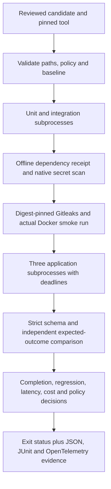

# Architecture and verification

The checker uses fixed argument arrays, no shell interpolation, strict JSON contracts, duplicate-key
rejection, candidate path containment and a symlink preflight. Every subprocess has a deadline.
Output size is checked after subprocess capture; this is not a streaming memory or adversarial
process-tree containment guarantee. Unexpected execution errors fail the affected gate. Missing
required files or malformed input prevent acceptance. Existing evidence directories are never reused.

Policy is package data, separate from the candidate. Its canonical case-suite hash binds the reviewed
baseline to the expected values and permitted tool calls. `claimed_verified` is compared with the
checker's own completion result; a false success claim cannot turn an incorrect value into a pass.
Baselines remain reviewable inputs: weakening a baseline or policy is not an automatic promotion.
The checker does not establish external world state beyond its fixture oracle.

Each run emits one local OpenTelemetry trace, one child span per executed gate and a benchmark span.
The report carries its trace ID, policy/suite hashes, UTC timestamp, run UUID, gate states and case
measurements. JSONL output retains per-case latency, completion, token accounting and failure reason.
No telemetry is exported over the network. Secrets are omitted from gate summaries; the Gitleaks
JSON uses scanner redaction. Artifacts contain reports, not the mutated candidate source.

Dependency receipts require every normalized lock package and version exactly once, the normalized
UTF-8 lock hash, pip-audit identity and a UTC date within the policy freshness window. This verifies
coverage and freshness of reviewed snapshot data, not cryptographic provenance of the scanner run.
A repository writer can change snapshots, tests and policy, so branch review and runner isolation
are deployment controls outside this package. Actual advisory refreshes use
[pip-audit's documented JSON output](https://github.com/pypa/pip-audit).

Gitleaks uses the pinned image recorded in `runner.py`, the package's default-extended rules, an empty
trusted ignore file and disabled inline allow annotations. Candidate ignore configuration cannot
suppress the required scan. The implementation follows the scanner's
[directory scanning and redaction interface](https://github.com/gitleaks/gitleaks).
Docker builds disable build-step networking, but base image retrieval can still use the daemon's
network. Smoke runs have no network, a read-only root, dropped capabilities and resource limits.

## Regression proof

`scripts/demo.py` copies the known fixture into new ignored paths. It checks actual CLI return codes,
the full required gate set for the valid candidate, and the intended failed gate for each mutation.
The secret mutation must fail both scanners. Mutations cover unit and integration assertions,
schema corruption, a synthetic dependency advisory, a random synthetic token, container build
failure, false verification, incorrect completion, excessive latency, excessive fixture cost and
an undeclared tool. A single defect may appropriately fail multiple gates.

The full harness test includes Docker/Gitleaks and is explicitly enabled by `GATES_CONTAINERS=1`.
Portable policy suites deselect that test. Local Windows full-suite and Linux clean-install portable
results are distinguished in committed evidence. The green remote delivery job must exercise the
full suite after publication; local checks alone never imply remote success. The dispatched
negative workflow should conclude `failure` at its unwrapped required gate step, with its artifact
confirming the selected defect. That expected failure is evidence of rejection, not a passing build.

These are controlled correctness and delivery fixtures. They do not establish production SLOs,
live-model quality, zero-day coverage, actual provider costs or arbitrary-agent safety.
